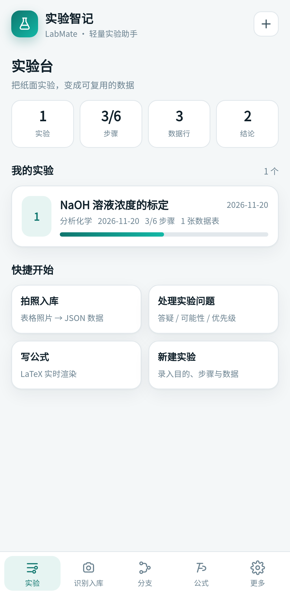
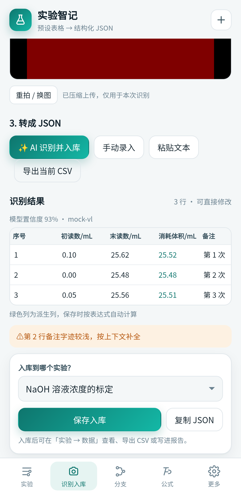
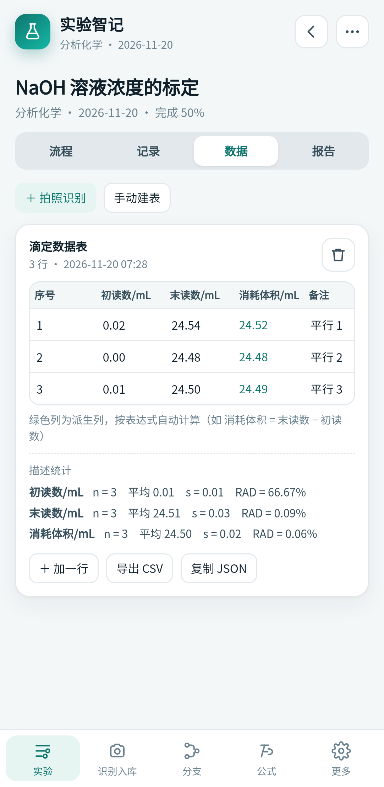
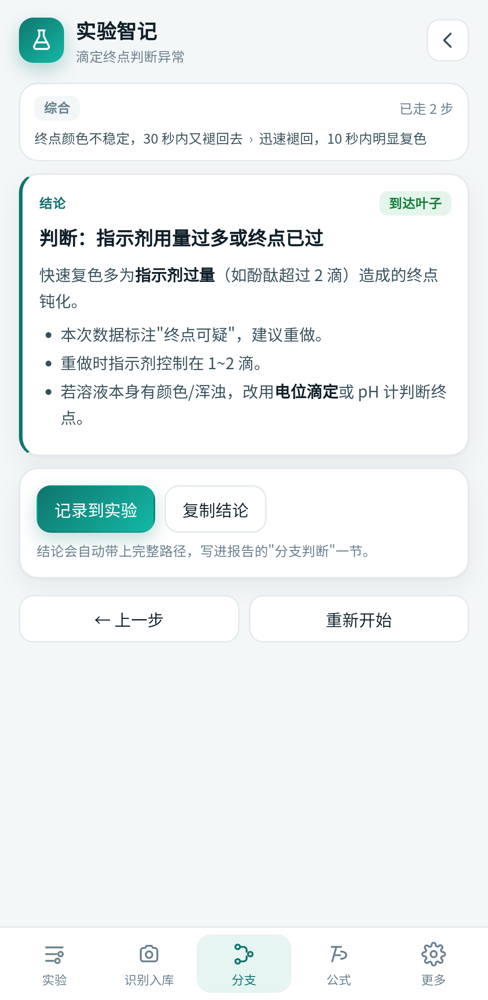
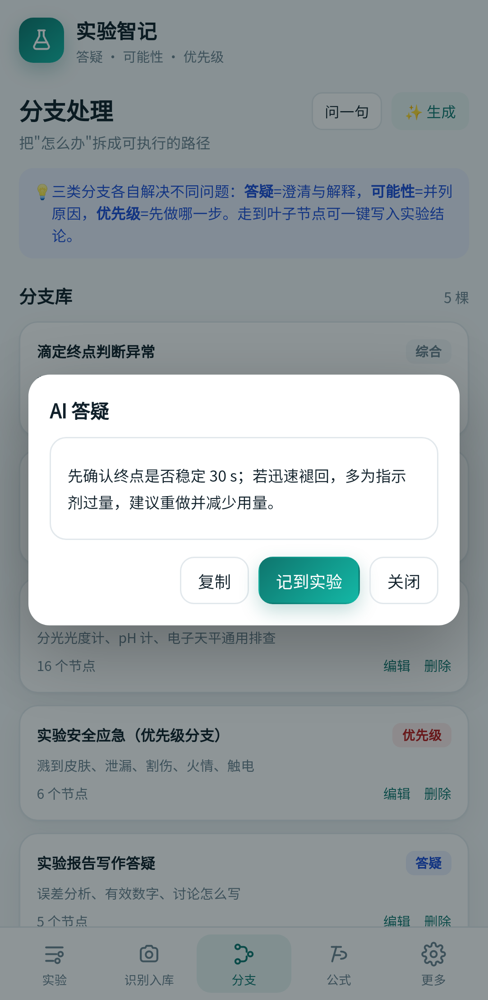
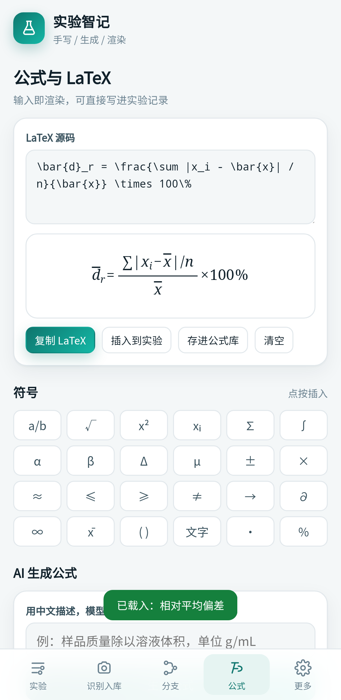
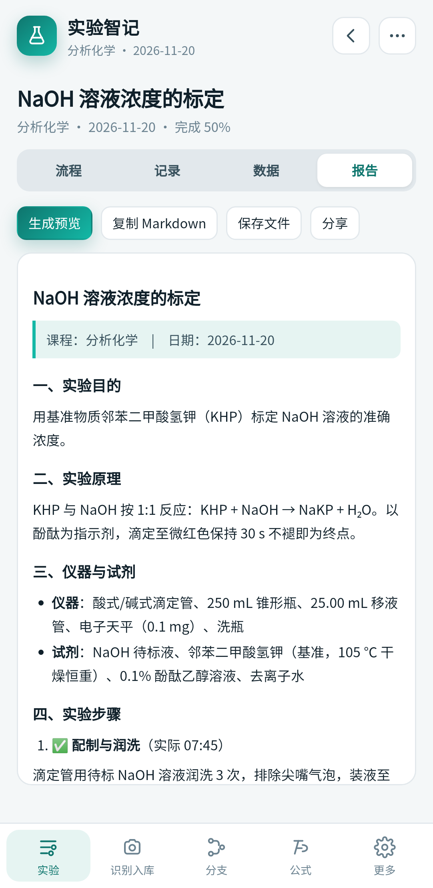

# 实验智记 LabMate

**把实验报告的预设表格拍照变成可入库的 JSON，用分支决策树处理实验过程中的问题，用离线 LaTeX 写公式，并记录整个实验流程的轻量安卓 App。**


- 包名 `com.labmate.app` ｜ 最低 Android 8.0（API 26）｜ 约 158 KB
- 原生 WebView 壳 + 纯 HTML/CSS/JS，**无框架、无运行时依赖、可完全离线**
- 无 Gradle 构建：`aapt2 + javac + d8 + jar + zipalign + apksigner`，Windows / macOS / Linux 通用
- 数据只存本机；除你配置的大模型接口外不上传任何内容



---

## 为什么做这个

现有的东西各管一段：表格 OCR 只出 Excel，ELN 重且面向机构，虚拟实验是仿真，AI 笔记不结构化，通用大模型答完就没了。**"拍照 → 固定 schema → 实验数据资产 → 报告"这条链，以及"怎么判断 / 先做什么"的分支决策，没有轻量工具覆盖。** 详细调研见 [docs/similar-products.md](docs/similar-products.md)。

| 能力 | 表格 OCR | ELN | 虚拟实验 | AI 笔记 | 通用大模型 | **LabMate** |
| --- | :-: | :-: | :-: | :-: | :-: | :-: |
| 拍照转表格 | ✅ | ⚠️ | ❌ | ⚠️ | ⚠️ | ✅ |
| 按预设 schema 出 JSON | ❌ | ⚠️ | ❌ | ❌ | ⚠️ | ✅ |
| 数据入库 / 可导出可统计 | ⚠️ | ✅ | ❌ | ❌ | ❌ | ✅ |
| 流程 + 计时 + 记录 | ❌ | ✅ | ⚠️ | ❌ | ❌ | ✅ |
| 答疑 / 可能性 / 优先级分支树 | ❌ | ❌ | ❌ | ❌ | ❌ | ✅ |
| LaTeX 公式离线渲染 | ❌ | ⚠️ | ❌ | ⚠️ | ⚠️ | ✅ |
| 报告自动生成 | ❌ | ⚠️ | ❌ | ⚠️ | ⚠️ | ✅ |
| 轻量 + 离线可用 | ⚠️ | ❌ | ❌ | ⚠️ | ❌ | ✅ |

---

## 功能

### 1. 拍照 → 预设表格 → JSON 入库



- 6 套内置模板（滴定、分光光度、物理测量、反应现象、称量、通用），列名/类型/小数位/派生列都可改
- 图片压缩到 1400 px 后交给视觉模型，按列定义提取；结果**逐格可改**，确认后入库
- 数字按列的小数位显示（`24.50` 不会变成 `24.5`），单位写在列名
- 带 `confidence / warnings / model / imageHash`，可疑处直接提示
- 无模型也能用：手动建表、粘贴文本解析

### 2. 数据表：派生列 + 描述统计



- **派生列**：`消耗体积/mL | calc | v1 - v0 | 2`，识别、录入、改单元格都会自动重算
- **描述统计**：n / 平均值 / 样本标准差 / 相对平均偏差（RAD），序号列自动跳过
- 报告里自动算出 `RAD = 0.06%` 这类平行样指标

### 3. 三分支决策树



| 分支 | 用途 | 字段 |
| --- | --- | --- |
| `qa` 答疑 | 澄清、追问、解释 | — |
| `possibility` 可能性 | 并列候选原因 | `prob` 概率条 |
| `priority` 优先级 | 处置顺序 | `level` P1~P5、`note` 耗时 |

内置 5 棵树（滴定终点、数据异常、仪器漂移、安全应急、报告写作），可编辑、可 AI 生成；走到叶子一键写入实验结论并带完整路径。另有 **AI 快问** 处理没写进树里的问题：



### 4. 离线 LaTeX 公式



自研渲染器（约 13 KB，无 KaTeX/MathJax）：分式、根式、上下标、求和/积分上下限、希腊字母、`\left...\right`、重音、`\text`。输入即渲染，可插入实验、存进公式库，也能让 AI 把中文描述转 LaTeX。

### 5. 流程录入与报告



- 步骤清单：计时（暂停累加）、勾选、写记录、排序；5 套流程模板，AI 可按实验目的生成
- 报告一键生成 Markdown：目的 / 原理 / 仪器试剂 / 步骤（含实际耗时）/ 数据表 / 数据处理 / 讨论 / 分支结论 / 公式 / 结论
- 预览、复制、保存 `.md`、系统分享

---

## 安装

从 [Releases](../../releases) 下载 `LabMate-x.y.z.apk`，允许"安装未知来源应用"后安装。首次可点「载入示例」查看完整示例实验。

只申请 `INTERNET` 与 `ACCESS_NETWORK_STATE`；相机走系统拍照 Intent，不申请相机权限。

### 配置大模型

任意 **OpenAI Chat Completions 兼容**接口：

| 服务商 | Base URL | 模型示例 |
| --- | --- | --- |
| OpenAI | `https://api.openai.com/v1` | `gpt-4o-mini`（识图需视觉模型） |
| DeepSeek | `https://api.deepseek.com/v1` | `deepseek-chat` |
| 通义千问 | `https://dashscope.aliyuncs.com/compatible-mode/v1` | `qwen-vl-max` |
| 智谱 GLM | `https://open.bigmodel.cn/api/paas/v4` | `glm-4v-flash` |
| Moonshot | `https://api.moonshot.cn/v1` | `moonshot-v1-8k-vision-preview` |
| 硅基流动 | `https://api.siliconflow.cn/v1` | `Qwen/Qwen2-VL-7B-Instruct` |
| 本地 Ollama | `http://127.0.0.1:11434/v1` | `qwen2.5vl:7b` |

- **拍照识别必须用视觉模型**（名字含 `4o / vl / vision / glm-4v / llava`）
- Key 只保存在本机 `localStorage`；请求由原生 `HttpURLConnection` 发出，无 CORS 限制，可连局域网
- 不配模型也能用全部离线功能

浏览器直接打开 [web/index.html](web/index.html) 也能用（AI 走 `fetch`，需要接口支持 CORS）。

---

## 构建与发布

需要 Node 18+、JDK 8+、Android SDK（build-tools + platforms）。

```bash
node tools/check.mjs                      # 语法 + 资源引用检查
node --test tests/*.test.mjs              # 12 项单元测试
node tools/build.mjs                      # → dist/LabMate-1.1.0.apk
node tools/package-release.mjs            # → dist/labmate-1.1.0.zip + SHA256SUMS.txt
```

Windows 也可用 `powershell -ExecutionPolicy Bypass -File android\build.ps1`。

不使用 Gradle 的原因、两个 Windows 特有的坑（aapt2 中文路径 / 反斜杠资源名）、自定义签名与 CI 说明见 **[docs/building.md](docs/building.md)**。

### 发到 GitHub

```bash
git init
git add .
git commit -m "feat: LabMate v1.1.0"
git branch -M main
git remote add origin https://github.com/<you>/labmate.git
git push -u origin main

git tag v1.1.0
git push origin v1.1.0      # 触发 release.yml：构建 APK 并创建 Release
```

`ci.yml` 在 push/PR 时跑检查与测试；`release.yml` 在 `v*` 标签时构建 APK、打包 zip 并发布。

---

## 数据结构

```jsonc
// 实验
{
  "id": "exp_x", "name": "NaOH 溶液浓度的标定", "course": "分析化学",
  "date": "2025-01-01", "aim": "...", "principle": "...",
  "steps": [{ "id": "st_x", "title": "润洗", "desc": "...", "done": true, "elapsed": 465 }],
  "data": [{
    "templateName": "滴定数据表",
    "columns": [
      { "key": "v0", "label": "初读数/mL", "type": "number", "digits": 2 },
      { "key": "dv", "label": "消耗体积/mL", "type": "calc", "expr": "v1 - v0", "digits": 2 }
    ],
    "rows": [{ "no": 1, "v0": 0.02, "v1": 24.54, "dv": 24.52 }],
    "meta": { "source": "photo", "model": "gpt-4o", "confidence": 0.93, "warnings": [] }
  }],
  "conclusions": [{ "branchTitle": "滴定终点判断异常", "path": [{ "label": "颜色褪回" }], "text": "..." }]
}

// 分支树
{
  "id": "br_x", "title": "滴定终点判断异常", "tag": "综合", "root": "n1",
  "nodes": [{
    "id": "n1", "type": "question", "title": "具体情况是？", "body": "支持 **加粗**",
    "options": [
      { "id": "o1", "label": "颜色褪回", "kind": "qa", "next": "n2" },
      { "id": "o2", "label": "体积异常", "kind": "possibility", "next": "n3", "prob": 0.5 },
      { "id": "o3", "label": "指示剂失效", "kind": "priority", "next": "n4", "level": 1, "note": "2 分钟" }
    ]
  }]
}
```

「更多 → 导出全部 JSON」导出整库，可整库导入恢复。

---

## 项目结构

```text
web/                        前端（同时是 APK 的 assets/www）
  index.html
  css/app.css               单文件样式（含旧 WebView 兜底）
  js/latex.js               离线 LaTeX 渲染器
  js/seeds.js               6 套表格模板 / 5 棵分支树 / 16 条公式
  js/core.js                工具函数 + localStorage 仓库 + Markdown
  js/ai.js                  OpenAI 兼容客户端 + 各任务提示词 + JSON 容错
  js/domain.js              流程 / 入库 / 派生列 / 统计 / 报告（纯逻辑）
  js/app.js                 路由 / 视图 / 事件委托 / 示例数据

android/                    WebView 壳
  java/com/labmate/app/MainActivity.java   资源拦截 / 相机 / HTTP 桥 / 保存分享
  res/                                     图标与主题
  gen-icons.py                             用 Pillow 生成图标
  build.ps1                                Windows 包装（调用 tools/build.mjs）

tools/
  build.mjs                 跨平台构建
  package-release.mjs       发布打包 + SHA256
  zip.mjs                   无依赖 ZIP 写入器
  check.mjs                 静态检查
  cdp.mjs                   WebView DevTools 自动化截图
  mock-llm.py               本地假模型（OpenAI 兼容），离线验证 AI 链路

tests/                      Node 单元测试（LaTeX / 派生列 / 统计 / 报告）
docs/                       竞品调研、构建说明、发布说明、截图
.github/                    CI / Release 工作流、Issue 与 PR 模板
```

---

## 隐私与边界

- 无账号、无埋点、无云端；数据只有一份 `localStorage`（键 `labmate.v1`）
- 图片只在内存中压缩后发给模型，不落盘、不入库（只存图片哈希）
- 识别结果必须人工复核：模型会认错数字、补全模糊备注，**`warnings` 与置信度就是给你看的**
- 公式渲染是子集实现，不含矩阵 / 多行对齐 / 化学式（`mhchem`）

## Roadmap

- [ ] 图片本地 OCR 兜底（无网络时粗提表格）
- [ ] 分支树支持回环、并行、条件表达式
- [ ] 数据表公式列支持聚合（平均值、极差）
- [ ] 数据表 → 标准曲线 / 折线图
- [ ] 报告导出 Word / PDF
- [ ] 深色模式（等目标 WebView 支持稳定后）
- [ ] 多设备同步（WebDAV / 局域网互传）

## 贡献

欢迎 Issue 与 PR。请先读 [CONTRIBUTING.md](CONTRIBUTING.md)：前端保持 ES5 风格、不引入依赖、不依赖 flex `gap`。安全问题见 [SECURITY.md](SECURITY.md)。

## 许可

[MIT](LICENSE) © 2026 LabMate contributors

---

*把纸面实验变成可复用的数据。*
